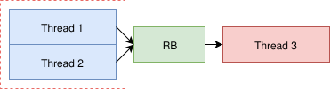
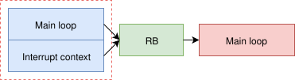
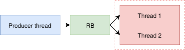
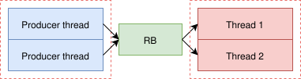

.. _thread_safety:

Thread safety
=============

Ring buffers are effectively used in embedded systems with or without operating systems.
Common problem most of implementations have, is linked to multi-thread environment (when using OS) or reading/writing from/to interrupts.
Question becomes *What happens if I write to buffer while another thread is reading from it?*

One of the main requirements (beside being lightweight) of *LwRB* was to allow *read-while-write* or *write-while-read* operations.
This is  achieved only when there is single write entry point and single read exit point.

    Write and read operation with single entry and exit points

Often called and used as *pipe* to write (for example) raw data to the buffer allowing another task
to process the data from another thread.

.. note::
    No race-condition is introduced when application uses LwRB with single write entry and single read exit point.
    LwRB uses *C11* standard ``stdatomic.h`` library to ensure read and write operations are race-free for any platform supporting C11 and its respected atomic library.

Thread (or interrupt) safety, with one entry and one exit points, is achieved by storing actual buffer read and write pointer variables to the local ones before performing any calculation.
Therefore multiple *conditional* checks are guaranteed to be performed on the same local variables, even if actual buffer pointers get modified.

* Read pointer could get changed by interrupt or another thread when application tries to write to buffer
* Write pointer could get changed by interrupt or another thread when application tries to read from buffer

.. note::
    Even single entry and single exit points may introduce race condition, especially on smaller system, such as 8-bit or 16-bit system, or in general,
    where the pointer type (``lwrb_sz_t``, ``unsigned long`` by default) is ``sizeof(type) > architecture_size``.
    This is solved by C11 atomic library, that ensures atomic reads and writes to key structure members.

Thread safety gets completely broken when application does one of the following:

* Uses multiple write entry points to the single LwRB instance
* Uses multiple read exit points to the single LwRB instance
* Calls read and write functions from the same multiple contexts at the same time

    Write operation to same LwRB instance from 2 threads.
    Write protection is necessary to ensure thread safety.

    Write operation to same LwRB instance from main loop and interrupt context.
    Write protection is necessary to ensure thread safety.

    Read operation from same LwRB instance from 2 threads.
    Read protection is necessary to ensure thread safety.

    Read and write operations are executed from multiple threads.
    Both, read and write, operations require exclusive access.

Above use cases are examples when thread safety gets broken. Application must ensure
exclusive access only to the part in *dashed-red* rectangle.

.. literalinclude:: ../examples_src/example_thread_safety.c
    :language: c
    :linenos:
    :caption: Thread safety example

Read and write operations can be used simultaneously hence it is perfectly valid if
access is granted to *read* operation while *write* operation from one thread takes place.

.. note::
    ``2`` different mutexes are used for read and write due to the implementation,
    allowing application to use buffer in *read-while-write* and *write-while-read* mode.
    Mutexes are used to prevent *write-while-write* and *read-while-read* operations respectively

.. tip::
    For *multi-entry-point-single-exit-point* use case, *read* mutex is not necessary.
    For *single-entry-point-multi-exit-point* use case, *write* mutex is not necessary.

.. _thread_safety_contexts:

Function contexts
^^^^^^^^^^^^^^^^^

A *context* is one thread or one interrupt. It may call library functions many times,
but never concurrently with itself. LwRB is lock-free for exactly one *write context* and one *read context*.

.. list-table::
    :header-rows: 1
    :widths: 20 45 35

    * - Context
      - Functions
      - Notes
    * - Write context
      - ``lwrb_write``, ``lwrb_write_ex``, ``lwrb_get_linear_block_write_address``,
        ``lwrb_get_linear_block_write_length``, ``lwrb_advance``
      - Modify write pointer only. Safe while read context runs in parallel
    * - Read context
      - ``lwrb_read``, ``lwrb_read_ex``, ``lwrb_peek``, ``lwrb_find``,
        ``lwrb_get_linear_block_read_address``, ``lwrb_get_linear_block_read_length``, ``lwrb_skip``
      - Modify read pointer only (``peek`` and ``find`` modify nothing, but rely on read pointer not moving).
        Safe while write context runs in parallel
    * - Any context
      - ``lwrb_is_ready``, ``lwrb_get_arg``, ``lwrb_get_free``, ``lwrb_get_full``
      - Modify nothing. ``lwrb_get_free`` is a guaranteed minimum only from write context,
        ``lwrb_get_full`` only from read context
    * - Not thread safe
      - ``lwrb_init``, ``lwrb_free``, ``lwrb_reset``, ``lwrb_set_evt_fn``, ``lwrb_set_arg``
      - Application must guarantee no other context uses the buffer

.. note::
    Event callback is called from the context of the function that triggered the event,
    see :ref:`events`.

Atomicity
^^^^^^^^^

While thread-safety concepts are very important, depending on the system architecture and variable sizes (and hardware cache),
application must also ensure that all the writes and reads to the internal variables are executed in atomic manner.

Especially critical case is when read/write from/to variable isn't ``1`` cycle on specific architecture (for instance 32-bit variable on 8-bit CPU).

Library (in its default configuration) uses ``stdatomic`` feature from *C11* language, and relies on a compiler to properly
generate necessary calls to make sure, all reads and writes are atomic.

.. note::
    Atomicity is required even if ring buffer is configured in *fifo* mode, with single write point and single read point.

.. tip::
    You can disable atomic operations in the library, by defining ``LWRB_DISABLE_ATOMIC`` global macro (typically with ``-D`` compiler option).
    It is then up to the developer to make sure architecture properly handles atomic operations.

.. warning::
    With ``LWRB_DISABLE_ATOMIC``, read and write pointers become plain (not even ``volatile``) variables,
    and there is no ordering guarantee left in the library.
    Compiler is free to reorder the data copy after the pointer update, so the other context
    may observe a new pointer before the data behind it is written or read.
    Application must add necessary barriers, ``volatile`` access or locking for the target platform.
